# IA-CRYPTO

**Datos públicos · Indicadores · Análisis educativo**

Un panel ligero para estudiar datos históricos y cotizaciones públicas. Solo lectura: no conecta cuentas ni ejecuta operaciones.

## Incluye

- Cotizaciones BTC, ETH y SOL desde Binance Public Market Data.
- Actualizaciones de precio mediante WebSocket público, con consulta REST alternativa.
- Historial configurable de 1 día, 4 horas y 1 hora.
- Gráfico de cierres, RSI(14) de Wilder, SMA(20) y variación del periodo.
- Explicaciones de indicadores sin señales de compra/venta ni promesas predictivas.
- Diseño adaptable a móvil y escritorio, sin claves API ni dependencias de compilación.

## Sitio

https://ppequepro-cmyk.github.io/IA-CRYPTO/

GitHub Pages publica desde `main` y la carpeta raíz.

## Datos y limitaciones

- REST: `https://data-api.binance.vision/api/v3`.
- WebSocket público: `wss://data-stream.binance.vision`.
- Disponibilidad, latencia y límites dependen del proveedor y de la red.
- Los indicadores describen datos históricos. No predicen precios ni garantizan resultados.
- El panel es de solo lectura: no hay conexión con wallets, cuentas ni ejecución de operaciones.
- No existe un modelo de aprendizaje automático ni una precisión predictiva validada en esta versión.

## Validación

Consulta [docs/VALIDACION.md](docs/VALIDACION.md) para conocer las fórmulas y los requisitos antes de evaluar un modelo predictivo.

GitHub Actions comprueba la sintaxis de JavaScript y la presencia de los archivos principales.

## Seguridad

No se solicitan ni almacenan claves privadas, frases semilla, credenciales o permisos de cuentas. Proyecto educativo, no asesoría financiera.
